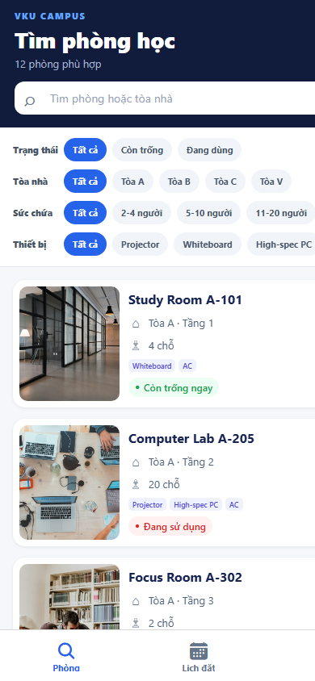
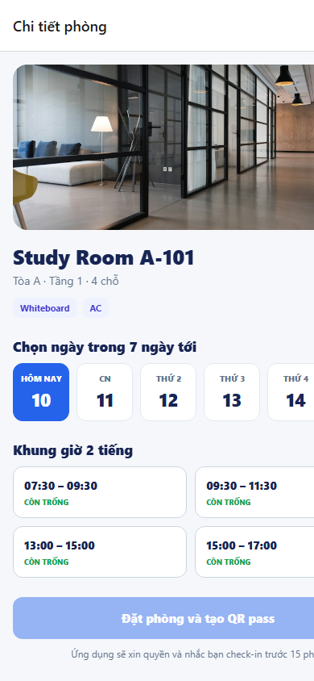
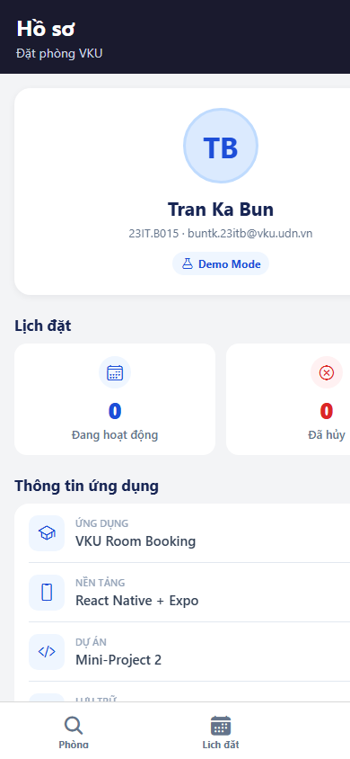

# MINI-PROJECT SHORT TECHNICAL REPORT

**Course:** Cross-Platform Mobile App Development (VKU)  
**Mini-Project Title:** Mini-Project 2 — Real-time Study Room Booking App  
**Student Name:** Tran Ka Bun  
**Student ID:** 23IT.B015  
**Email:** buntk.23itb@vku.udn.vn  
**Submission Date:** 10/10/2026

---

## 1. GENERAL INFORMATION & DELIVERABLE LINKS

- **Team Members:**
  1. Tran Ka Bun — Student ID: 23IT.B015 — Role: Full-stack Mobile Developer — Contribution: 100%
- **APK / Install URL:** https://expo.dev/accounts/kabun/projects/vku-room-booking/builds/eabbb550-9ce3-4218-9722-62859921829a
- **Local APK:** `builds/VKU-Room-Booking-v1.0.0.apk`
- **GitHub Repository:** https://github.com/bunwg29/room-booking
- **Video Demo:** Not provided.

---

## 2. FEATURE IMPLEMENTATION CHECKLIST

| # | Required Feature | Status | Implementation Details & Acceptance Level |
|:---:|---|:---:|---|
| 1 | Room discovery and responsive `FlatList` | ✅ Complete | 12 room cards with image, building, capacity, equipment, and Available Now/Occupied state. Responsive 1/2/3-column layout and memoized rendering. |
| 2 | Multi-parameter filters | ✅ Complete | Instant search plus status, building A/B/C/V, capacity 2–20, and equipment filters. Filters can be combined. |
| 3 | Seven-day, two-hour slot selector | ✅ Complete | Seven local dates and four discrete slots: 07:30–09:30, 09:30–11:30, 13:00–15:00, 15:00–17:00. |
| 4 | Conflict prevention | ✅ Complete | Booked slots are disabled in the UI; the store independently rejects overlapping bookings for the same room/date. |
| 5 | Unique booking pass and QR check-in | ✅ Complete | Each reservation receives a unique pass code and a scannable QR payload. The modal supports simulated check-in. |
| 6 | Global booking/session state | ✅ Complete | Zustand owns the user session, reservations, cancellation, check-in, and derived availability. |
| 7 | Offline persistence | ✅ Complete | Zustand `persist` middleware stores bookings and session in AsyncStorage. |
| 8 | Local reminders | ✅ Complete | `expo-notifications` schedules a local reminder 15 minutes before the slot and cancels it after cancellation/check-in. |

---

## 3. TECHNICAL ARCHITECTURE & PROJECT STRUCTURE

```text
src/
├── app/          Expo Router routes, stack and bottom tabs
├── components/   Room cards and QR booking-pass modal
├── data/         Typed demo room catalogue
├── hooks/        React Query room-loading hook
├── screens/      Discovery, detail, confirmation, bookings, profile
├── services/     Data access, overlap rules, local notifications
├── store/        Persisted Zustand booking/session store
└── types/        Room, equipment, time-slot and booking models
```

The UI reads rooms through a data-source boundary and React Query. User actions flow from Expo Router screens to the Zustand store. `addBooking` revalidates the overlap rule before saving, schedules a reminder when permission is available, and persists the result through AsyncStorage. Derived selectors combine static demo occupancy with active local bookings, so room cards and time slots update immediately.

Notification failures do not invalidate a reservation. Unsupported web APIs are guarded by platform checks, and the booking remains usable when notification permission is denied. Cancellation and check-in are idempotent state transitions and also cancel any scheduled reminder.

---

## 4. EMPIRICAL EVIDENCE & SCREENSHOTS

### 4.1 Room discovery and multi-parameter filters



The discovery screen exposes live status, building, capacity, and equipment chips above the virtualized room list.

### 4.2 Seven-day selector and conflict-aware slots



The detail screen presents seven dates and discrete two-hour slots. Existing or current occupied slots are disabled, and the booking action remains disabled until a valid slot is selected.

### 4.3 Persisted student session



The profile confirms the persisted student identity and summarizes active/cancelled reservations.

---

## 5. TECHNICAL CHALLENGES & RESOLUTIONS

1. **Conflict prevention at two layers.** Disabling a slot in the UI alone can become stale. The solution centralizes interval-overlap logic in `bookingService` and repeats the check inside the Zustand action before persistence.
2. **Cross-platform notification behavior.** The native notification response API is unavailable on web. Platform guards keep the web demo stable, while Android/iOS schedule a date trigger exactly 15 minutes before the booking and deep-link to its pass.

### Verification

| Check | Result |
|---|:---:|
| `npm run lint` | PASS |
| `npm run typecheck` | PASS |
| `npx expo-doctor` (21 checks) | PASS |
| `npx expo export --platform web` | PASS |
| Browser smoke test at 390 × 844 | PASS |

### Known limitation

The current catalogue and availability source are local demo data. There is no authenticated backend or multi-device synchronization, and a video demo has not yet been supplied. These are delivery gaps rather than missing on-device booking functions.
